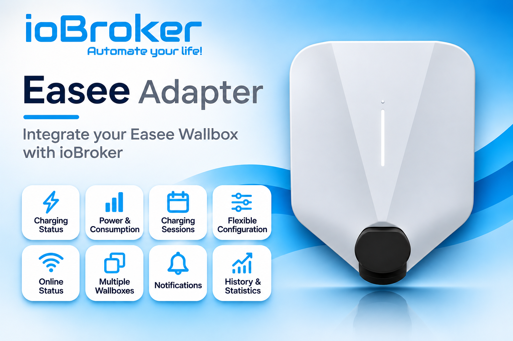

# ioBroker.easee

<!--  -->

## easee adapter for ioBroker

Adapter to connect Easee Wallbox

## Help

`status.authToken` and `status.authTokenName` are cleared when charging starts (Easee Observation 109). The API does not provide the token at session start. The adapter checks for a completed session when the charger enters Completed mode or the car disconnects. Once Easee returns a token, it is stored in `status.authToken`; the adapter looks up the key owner in the logged-in account's Easee Keys and writes the name to `status.authTokenName`. The name is `unknown` if no matching name is available or the lookup fails. Both states remain empty until a token is available. Keys belonging to other accounts may not be resolvable.

`status.chargerOpMode` reports the charger's operation mode (Easee Observation 109):

| Value | Mode | Description |
| ---: | --- | --- |
| 0 | Offline | Charger is offline. |
| 1 | Disconnected | No car is connected. |
| 2 | Awaiting Start | A car is connected; the charger is waiting for the EV or load balancing. |
| 3 | Charging | The car is charging. |
| 4 | Completed | The car has paused or stopped charging. |
| 5 | Error | The charger has an error. |
| 6 | Ready to Charge | The charger is waiting for the car to take energy. |
| 7 | Awaiting Authentication | The charger is waiting for authentication. |
| 8 | De-authenticating | The charger is de-authenticating. |

The `<chargerId>.name` state can be written to change the charger name in Easee. The adapter reads the charger's circuit and submits its complete charger list to Easee, then confirms the state only when the name is returned by the API. The Easee account must have permission to update chargers on the site. Since Easee does not document all update semantics, test this feature on a test site first and check the adapter log if the update is rejected or not confirmed.

dynamicCircuitCurrentPX -> All phases must be set within 500ms (script) otherwise the phase will be set to 0.    

Session polling can run automatically at a recommended interval of seven minutes per detected charger, or use a manually selected interval per charger. The Admin configuration shows the detected charger count, recommendation, and effective interval. Manual values below the recommendation are raised automatically to preserve the API rate limit. The last session request time is retained across adapter restarts.

## Credits

This adapter would not have been possible without the great work of @Newan (https://github.com/Newan), who developed former releases of this adapter.

## Changelog
<!--
  Placeholder for the next version (at the beginning of the line):
  ### **WORK IN PROGRESS**
-->
### **WORK IN PROGRESS**
- (Voodoo2man) Added the ability to change the charger name through the writable `<chargerId>.name` state.
- (Voodoo2man) Replaced the adapter icon.
- (Voodoo2man) Added an authorization token datapoint that is cleared when charging starts and set after the session, with a separate owner-name datapoint.

### 3.1.0 (2026-11-01)
- (Voodoo2man) Corrected cable-lock status reporting and improved the reliability of charger status updates.
- (Voodoo2man) Added a readable and adjustable permanent cable-lock setting, kept separate from the actual cable-lock status.
- (Voodoo2man) Improved recovery of live charger updates after connection interruptions while retaining regular status updates when live updates are disabled.

### 3.0.0 (2026-10-23)
- (Voodoo2man) Migrated the adapter to TypeScript; Node.js 22.19.0 or newer is required
- (Voodoo2man) Updated adapter tooling, Admin configuration, and runtime metadata

### 2.0.0 (2026-10-18)
- (Voodoo2man) Improved charger status and connectivity handling with the Observations API, SignalR resilience, bounded polling, and API retries, incorporating contributions from @Voodoo2man, @Michaelnorge, @Codibris, and @m1chel87, with earlier Node.js and JSON-config groundwork from @NCIceWolf.
- (Voodoo2man) Improved circuit-current update reliability and added configurable, rate-limit-aware session polling across chargers.
- (Voodoo2man) Added configurable net charging prices and VAT with synchronized gross prices.

### 2.0.0-alpha.1 (2026-10-17)
- (mcm1957) Adapter has been migrated into the iobroker-community-adapter-organisation
- (iobroker-bot) Adapter requires node.js >= 22 now.
- (copilot) Adapter requires js-controller >= 7.2.2 now
- (copilot) Adapter requires admin >= 7.7.22 now

### 1.0.10 (2023-07-27)
* (Newan) fix version number

[Older changelogs can be found there](CHANGELOG_OLD.md)

## Donation

## License
MIT License

Copyright (c) 2026 iobroker-community-adapters <iobroker-community-adapters@gmx.de>  
Copyright (c) 2025 Newan <iobroker@newan.de>

Permission is hereby granted, free of charge, to any person obtaining a copy
of this software and associated documentation files (the "Software"), to deal
in the Software without restriction, including without limitation the rights
to use, copy, modify, merge, publish, distribute, sublicense, and/or sell
copies of the Software, and to permit persons to whom the Software is
furnished to do so, subject to the following conditions:

The above copyright notice and this permission notice shall be included in all
copies or substantial portions of the Software.

THE SOFTWARE IS PROVIDED "AS IS", WITHOUT WARRANTY OF ANY KIND, EXPRESS OR
IMPLIED, INCLUDING BUT NOT LIMITED TO THE WARRANTIES OF MERCHANTABILITY,
FITNESS FOR A PARTICULAR PURPOSE AND NONINFRINGEMENT. IN NO EVENT SHALL THE
AUTHORS OR COPYRIGHT HOLDERS BE LIABLE FOR ANY CLAIM, DAMAGES OR OTHER
LIABILITY, WHETHER IN AN ACTION OF CONTRACT, TORT OR OTHERWISE, ARISING FROM,
OUT OF OR IN CONNECTION WITH THE SOFTWARE OR THE USE OR OTHER DEALINGS IN THE
SOFTWARE.
